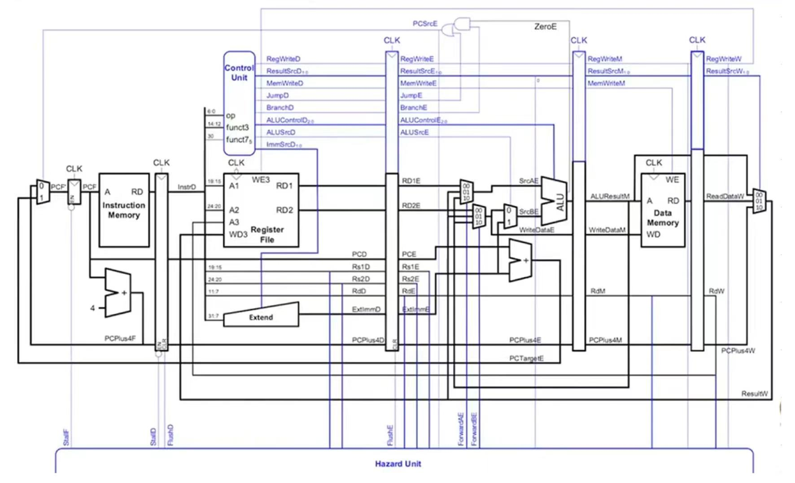
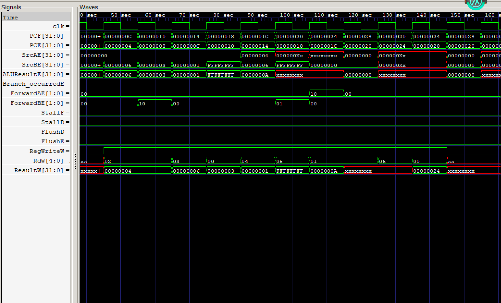
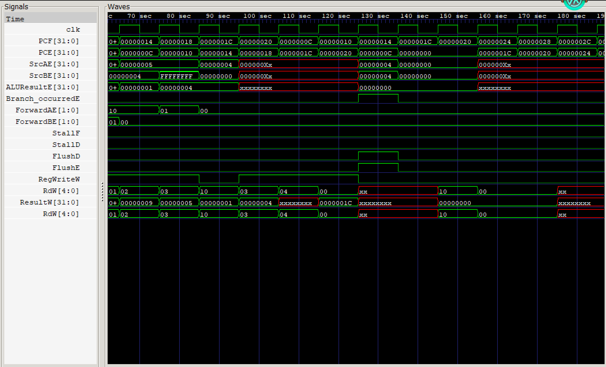

# RV32I 5-Stage Pipelined Processor

## Overview
This project implements a basic 32-bit, five-stage pipelined RISC-V processor in SystemVerilog, supporting a subset of the RV32I base instruction set.

## Microarchitecture Features


> *Architecture diagram inspied by "Digital Design and Computer Architecture" (Harris & Harris).*
- 5-Stage Pipeline: IF(Instruction Fetch), ID(Decode), EX(Execute), MEM(Memory), WB(Writeback)
- Hazard Solution
  - Data Hazards: Implemented data forwarding from both the EX and MEM stages.
  - Load-Use Hazards:Implemented hazard detection and handling using pipeline stalls.
  - Control Hazards:Implemented a pipeline flush mechanism for branch mispredictions.

## Supported ISA
- Arithmetic: add, sub, addi
- Memory Access: lw, sw
- Control Flow: beq, jal

## Simulation & Verification
- Simulation Tools: Icarus Verilog + GTKWave
- Test Case A: data hazard(Forwarding Verification)

```
00400113
00600193
00300013
00100213
FFF00293
003100B3
005200B3
00008333
0000006F
```
>*addi x2, x0, 4
addi x3, x0, 6
addi x0, x0, 3
addi x4, x0, 1
addi x5, x0, -1
add x1, x2, x3
add x1, x4, x5
add x6, x1, x0
jal x0, 0*




- Test Case B: control hazard(Branch Flush Verification)

```
00400093
00508113
401101B3
00118863
FFF18193
0000A203
FF5FF06F
0000006F
```

> *addi x1, x0, 4
addi x2, x1, 5
sub x3, x2, x1
beq x3, x1, 16
addi x3, x3, -1
lw x4, 0(x1)
jal x0, -12
jal x0, 0*



## Quick Start
To run the simulation:
Edit memfile.dat and insert the desired machine instructions in hexadecimal format.
Run the following commands in the terminal to generate and view the waveform:

```
iverilog -g2012 -o cpu.out *.sv tb/tb_top.sv
vvp cpu.out
gtkwave cpu_wave.vcd
```
